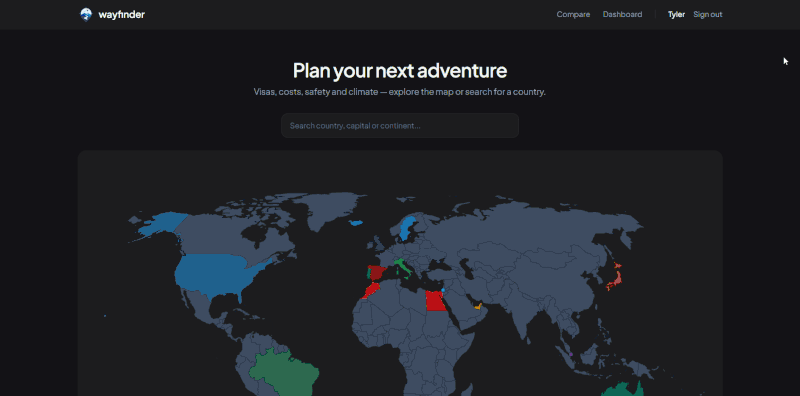
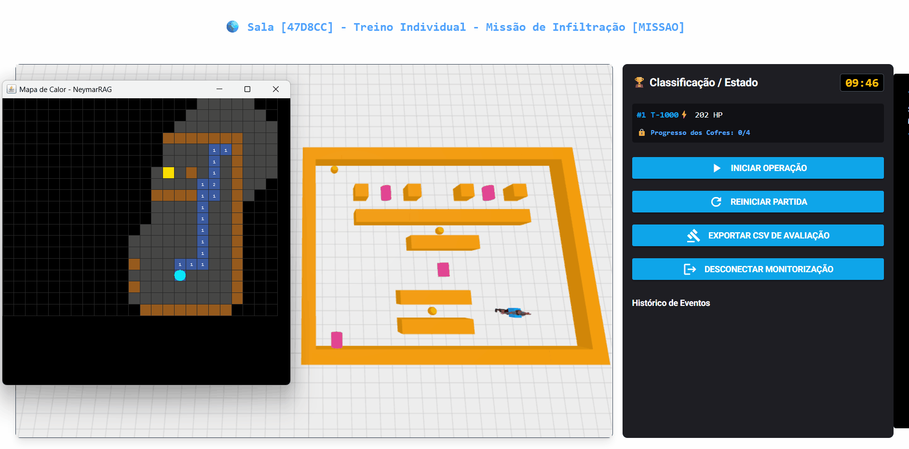
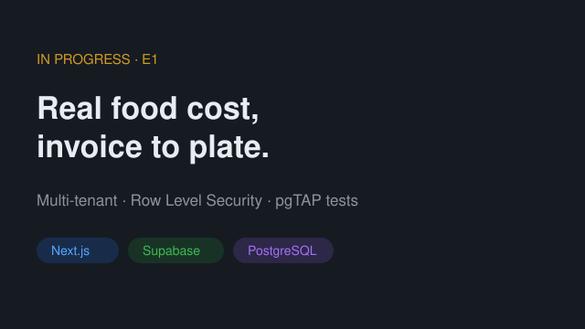
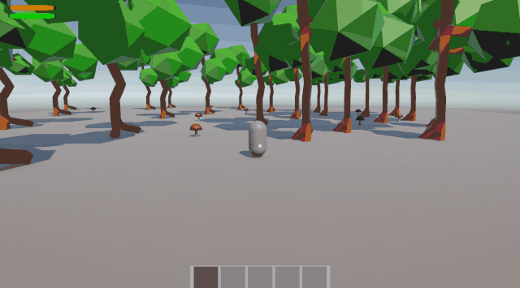
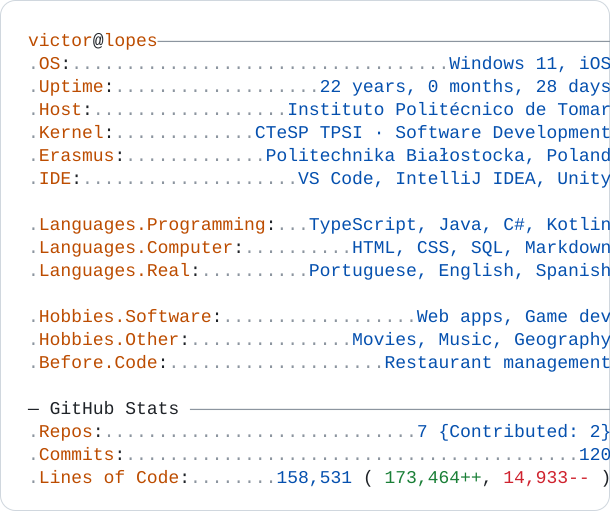

### Hi, I'm Victor 👋

🔭 Currently building **restaurant-food-cost**, a food cost tracker for independent restaurants 
🎓 Software development student · Polytechnic University of Tomar · Erasmus in Poland 
🍽️ Before code: F&B manager leading a team of 35 
🔎 Looking for a curricular internship in software development (640 h, spring 2027) · Portugal, EU or remote

  

#### Featured projects

<table>
  <tr>
    <td width="50%" valign="top">
      
       <a href="https://github.com/MarcondezVictor/wayfinder"><b>wayfinder</b></a>
       Travel planning platform: interactive map, visas, costs and trip comparison. <a href="https://way-finder-fawn.vercel.app">Live demo ↗</a>
       Next.js · TypeScript · Supabase
    </td>
    <td width="50%" valign="top">
      
       <a href="https://github.com/kv4044/RobotRAG"><b>RobotRAG</b></a> 🏆
       Autonomous robot for a 3D arena with a local RAG pipeline (Ollama). Class champion.
       Java · Ollama · RAG
    </td>
  </tr>
  <tr>
    <td width="50%" valign="top">
      
       <a href="https://github.com/MarcondezVictor/restaurant-food-cost"><b>restaurant-food-cost</b></a>
       Food cost tracker built for a real restaurant, from purchase invoice to the cost of every dish.
       Next.js · Supabase · PostgreSQL
    </td>
    <td width="50%" valign="top">
      
       <a href="https://github.com/MarcondezVictor/survival-3d"><b>survival-3d</b></a>
       First-person survival game prototype: gathering, inventory, hunger, building and NavMesh wildlife.
       Unity · C#
    </td>
  </tr>
</table>

Also: [countrypedia](https://marcondezvictor.github.io/countrypedia/) (197-country encyclopedia, live) · [finance-manager](https://github.com/MarcondezVictor/finance-manager) (Next.js + Strapi finance app) · contributor to [UniPortal](https://uniportal-nu-murex.vercel.app) (30-student university portal)

More about me

 

<a href="https://github.com/MarcondezVictor">
  <picture>
    <source media="(prefers-color-scheme: dark)" srcset="dark_mode.svg">
    
  </picture>
</a>

#### Connect

<!-- LinkedIn: TODO — paste the profile URL into href and move this line out of the comment:

-->

